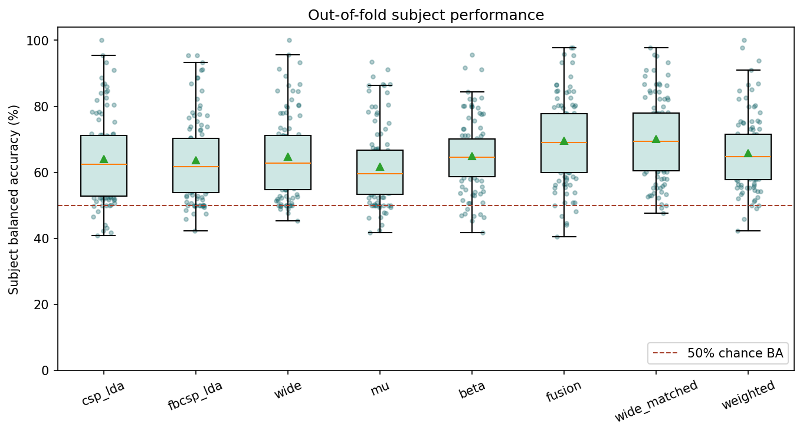
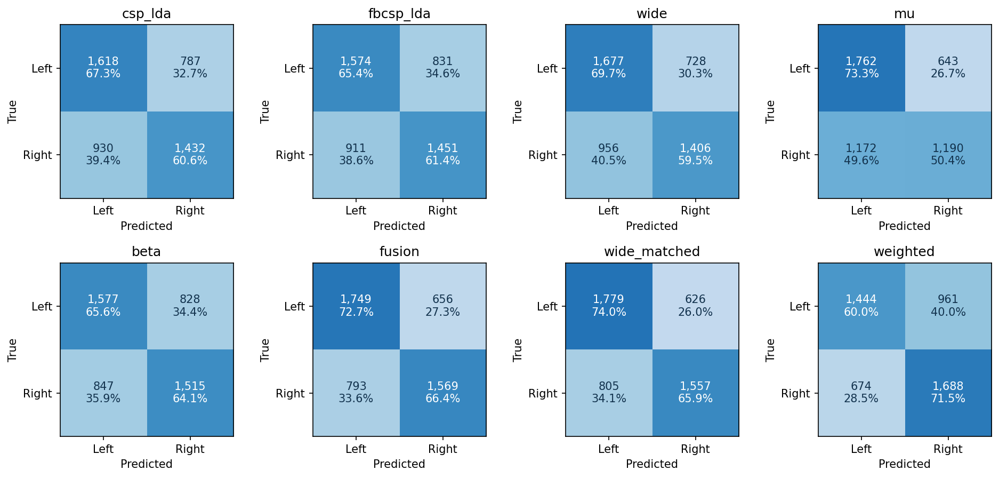
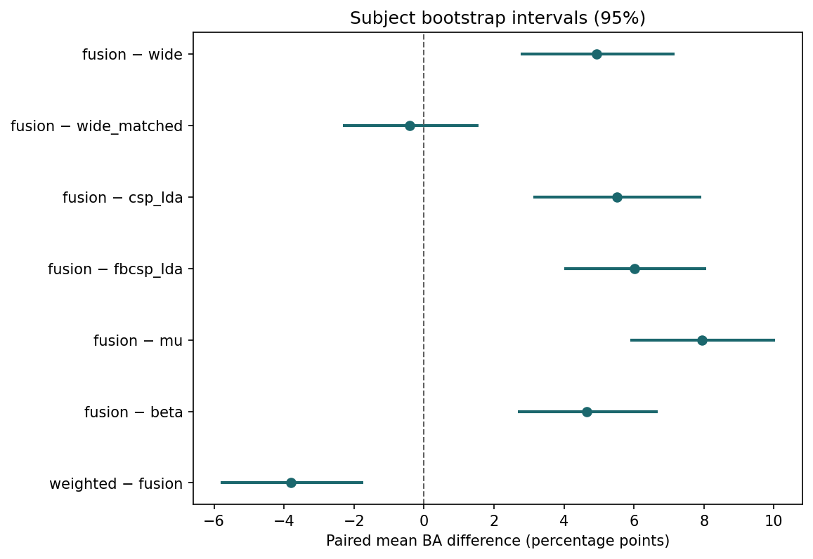
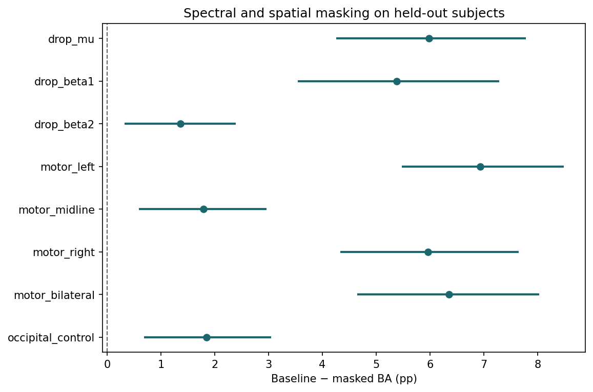
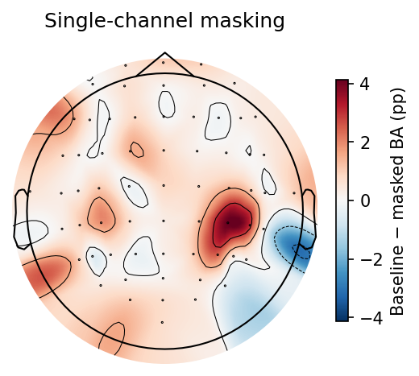
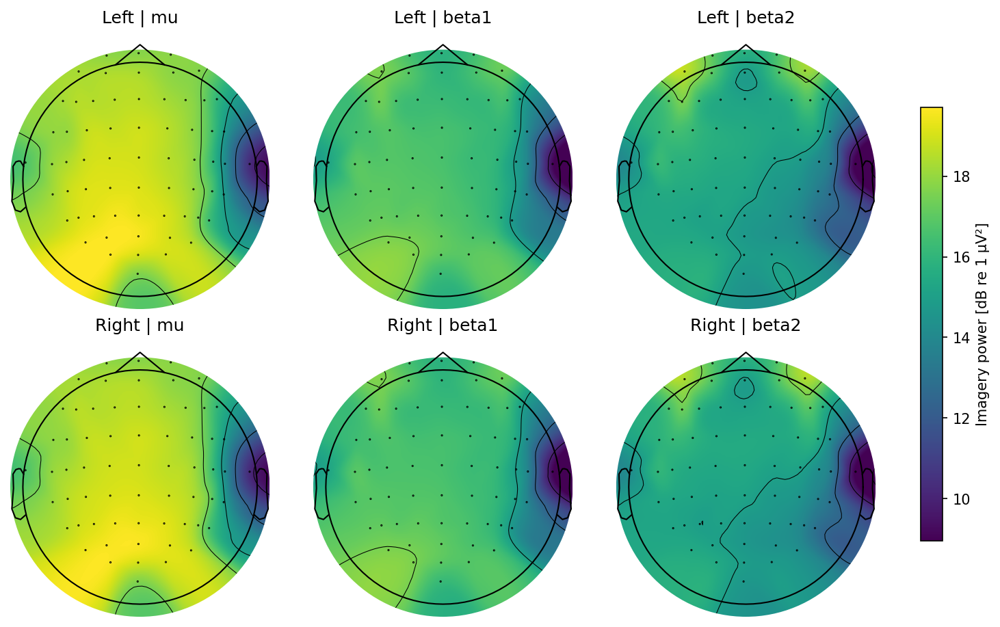
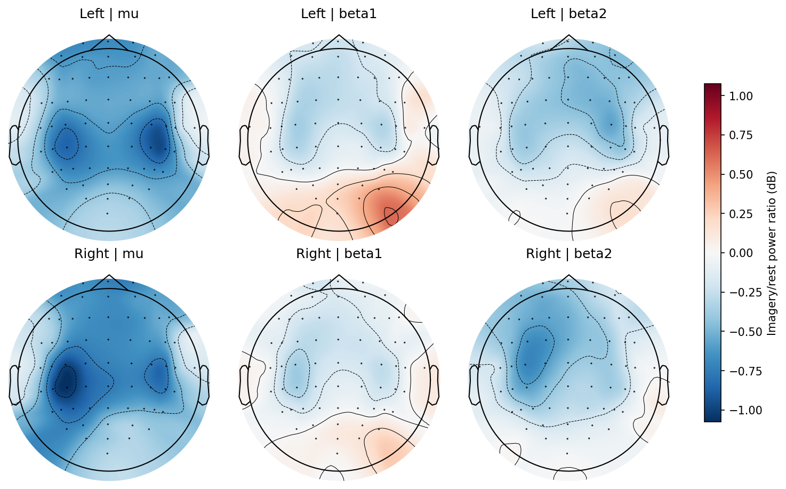

# 跨被试运动想象识别实验结果

运行配置为 **full**，设备为 `cpu`，随机种子为 2026。测试覆盖 **106 名被试、4,767 个试次**（左手 2,405、右手 2,362）。其中 4,767 个试次有可用的同次试验前 T0 基线。

每名被试仅出现在一个外层测试折。被试级指标先在同一被试内计算，再对被试等权平均。下表的折间标准差取各折被试等权平均后的样本标准差。训练用时为各折拟合与选参耗时的中位数。传统模型的试次协方差在计时前逐频段计算。

质控后没有可用于二分类的数据的被试为 S088, S092, S100。被试、记录与试次的审计见 [qc.csv](qc.csv)。

| 模型 | 被试均值 BA | 被试均值 Macro-F1 | 被试均值 Accuracy | 折间 BA 均值 ± SD | 参数量 | 每折耗时中位数 |
|---|---:|---:|---:|---:|---:|---:|
| csp_lda | 64.11% | 60.52% | 63.97% | 64.12% ± 2.30 pp | 见模型统计表 | 0.3 s |
| fbcsp_lda | 63.61% | 59.98% | 63.45% | 63.61% ± 2.95 pp | 见模型统计表 | 0.9 s |
| wide | 64.70% | 61.20% | 64.67% | 64.74% ± 2.87 pp | 974 | 22.8 s |
| mu | 61.69% | 57.73% | 61.92% | 61.73% ± 3.19 pp | 974 | 26.2 s |
| beta | 64.98% | 63.56% | 64.86% | 64.98% ± 1.88 pp | 974 | 29.7 s |
| fusion | 69.63% | 68.48% | 69.60% | 69.65% ± 2.91 pp | 2,918 | 82.2 s |
| wide_matched | 70.04% | 68.08% | 69.98% | 70.07% ± 2.24 pp | 2,983 | 56.9 s |
| weighted | 65.83% | 63.83% | 65.70% | 65.82% ± 2.20 pp | 3,321 | 76.1 s |

## 配对差值与频段融合

**主要对照。** 拼接融合相对宽频 EEGNet 的被试平均 BA 差值为 +4.93 个百分点。区间整体为正，本次观察支持拼接融合在该划分下提高 BA。

**参数量对照。** 拼接融合相对加宽宽频模型的 BA 差值为 -0.42 个百分点，95% 区间为 [-2.32, +1.56] 个百分点。

配对检验的单位为被试。以下区间为 10,000 次被试重抽样的 95% 百分位区间。外层各折共享部分训练被试，统计结果用于描述本次协议下的配对差异。

| 对照（前者减后者） | 差值（pp） | 95% CI（pp） | Holm 校正 p |
|---|---:|---:|---:|
| fusion − wide | +4.93 | [+2.76, +7.16] | 0.0002865 |
| fusion − wide_matched | -0.42 | [-2.32, +1.56] | 0.5887 |
| fusion − csp_lda | +5.52 | [+3.12, +7.91] | 0.0002119 |
| fusion − fbcsp_lda | +6.02 | [+4.01, +8.07] | 3.995e-06 |
| fusion − mu | +7.94 | [+5.89, +10.03] | 3.675e-09 |
| fusion − beta | +4.65 | [+2.68, +6.67] | 0.0003247 |
| weighted − fusion | -3.79 | [-5.80, -1.73] | 0.001993 |

## 头皮分布与遮蔽

在各外层折的测试数据上，将标准化后的对应频段或通道置零，保持其它输入与模型权重固定。BA 降幅按被试配对计算，正值表示遮蔽后 BA 下降。地形图描述模型对电极信号的依赖，遮蔽会改变输入分布。

| 遮蔽条件 | 平均 BA 降幅（pp） | 95% CI（pp） |
|---|---:|---:|
| drop_mu | +5.98 | [+4.26, +7.78] |
| drop_beta1 | +5.38 | [+3.54, +7.28] |
| drop_beta2 | +1.37 | [+0.32, +2.39] |
| motor_left | +6.93 | [+5.48, +8.48] |
| motor_midline | +1.79 | [+0.59, +2.96] |
| motor_right | +5.96 | [+4.33, +7.65] |
| motor_bilateral | +6.35 | [+4.65, +8.03] |
| occipital_control | +1.85 | [+0.68, +3.05] |

频带功率来自事件后 [0.5, 2.5) 秒。ERD/ERS 用同试次的事件前 [−2.25, −0.25) 秒 T0 功率作参考。负 dB 表示功率降低，正 dB 表示功率升高。图中各类别先在被试内平均，再对被试等权平均。运动节律、视觉提示和记录噪声都可能影响头皮分布。

## 复核文件

- [模型统计与选择结果](model_fits.csv)
- [每个被试的指标](subject_metrics.csv)
- [每折指标](fold_metrics.csv)与[折间均值和标准差](fold_metric_summary.csv)
- [全部测试预测](predictions.csv)与[配对统计](paired_comparisons.csv)
- [运行环境和被试划分](study.json)与[可用试次表](trials.csv)
- [频带功率与 ERD 数表](spectral_channel_summary.csv)
