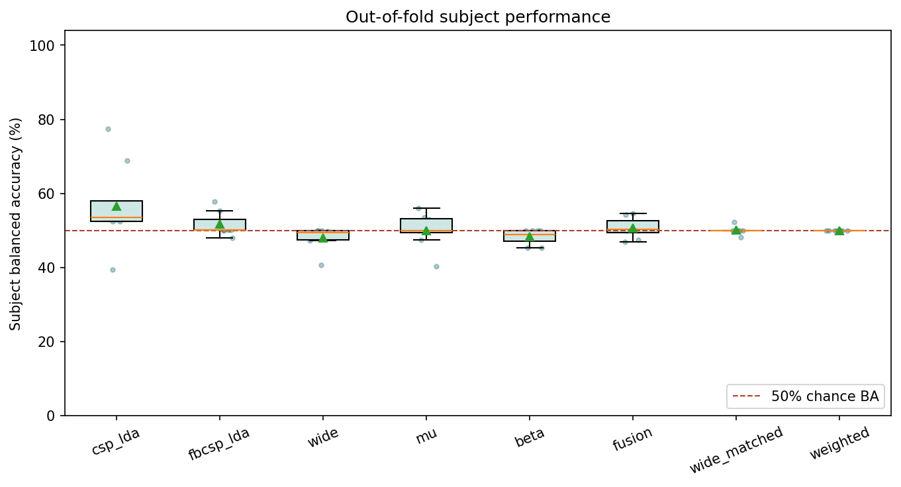
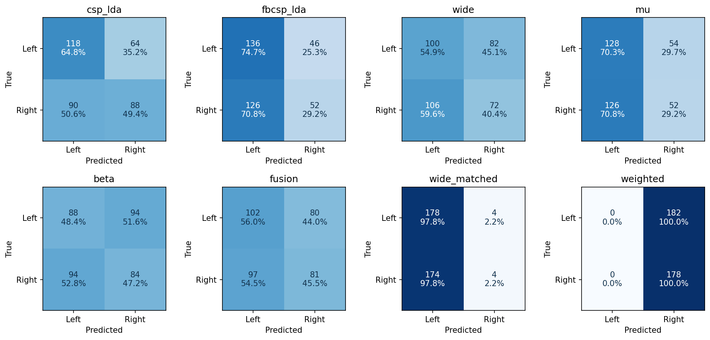
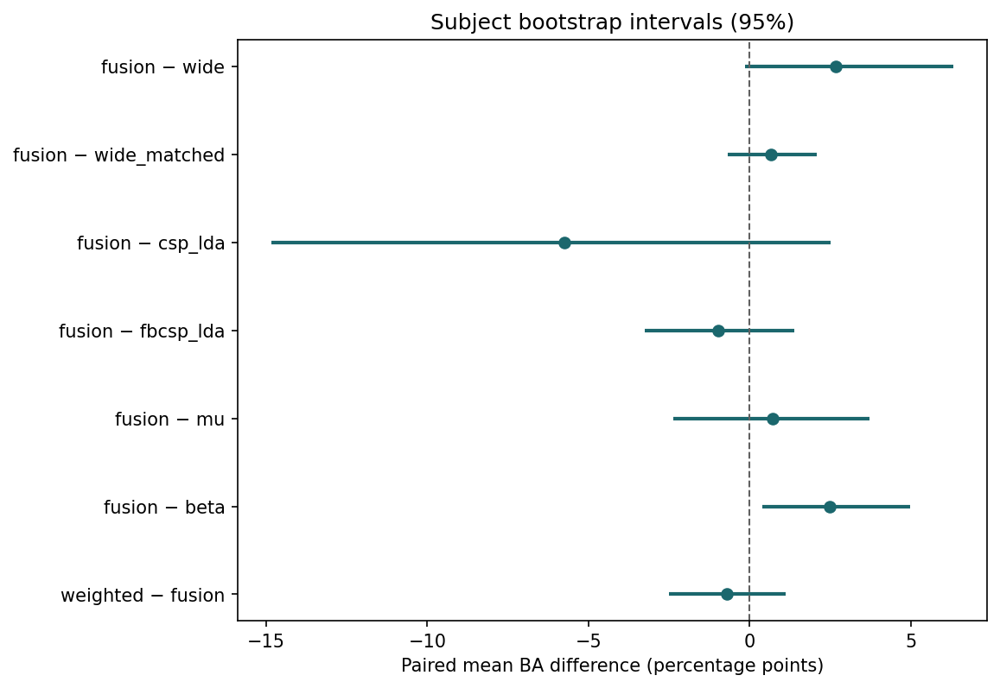
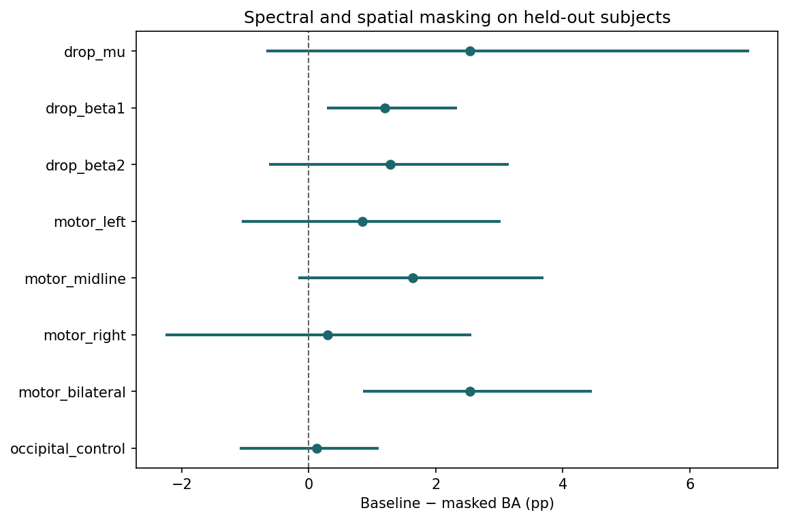
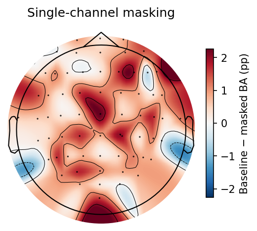
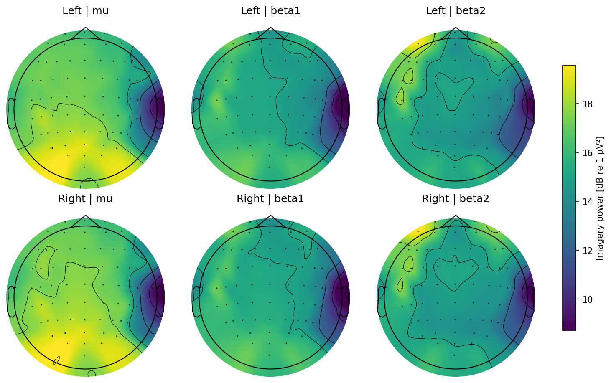
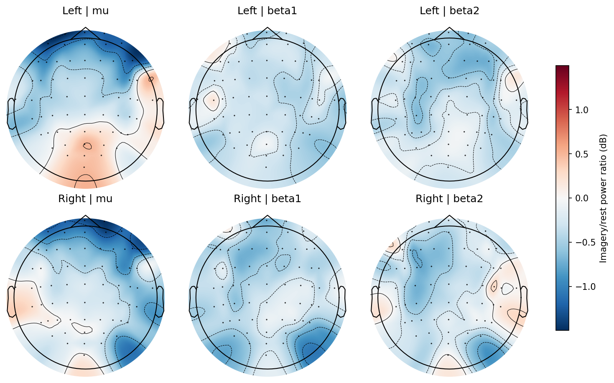

# 跨被试运动想象识别实验结果

运行配置为 **quick**，设备为 `cpu`，随机种子为 2026。测试覆盖 **8 名被试、360 个试次**（左手 182、右手 178）。其中 360 个试次有可用的同次试验前 T0 基线。

每名被试仅出现在一个外层测试折。被试级指标先在同一被试内计算，再对被试等权平均。下表的折间标准差取各折被试等权平均后的样本标准差。训练用时为各折拟合与选参耗时的中位数。传统模型的试次协方差在计时前逐频段计算。

**快速模式只用于验证流程。**

| 模型 | 被试均值 BA | 被试均值 Macro-F1 | 被试均值 Accuracy | 折间 BA 均值 ± SD | 参数量 | 每折耗时中位数 |
|---|---:|---:|---:|---:|---:|---:|
| csp_lda | 56.46% | 50.14% | 57.22% | 58.31% ± 13.03 pp | 见模型统计表 | 0.0 s |
| fbcsp_lda | 51.68% | 41.92% | 52.22% | 51.80% ± 0.97 pp | 见模型统计表 | 0.1 s |
| wide | 48.05% | 37.96% | 47.78% | 48.10% ± 2.12 pp | 974 | 1.3 s |
| mu | 50.01% | 42.34% | 50.00% | 49.80% ± 1.59 pp | 974 | 0.2 s |
| beta | 48.25% | 33.71% | 47.78% | 48.31% ± 2.02 pp | 974 | 0.1 s |
| fusion | 50.72% | 40.86% | 50.83% | 50.49% ± 1.69 pp | 2,918 | 0.5 s |
| wide_matched | 50.05% | 35.13% | 50.56% | 49.94% ± 0.85 pp | 2,983 | 0.3 s |
| weighted | 50.00% | 33.08% | 49.44% | 50.00% ± 0.00 pp | 3,321 | 0.5 s |

## 配对差值与频段融合

**主要对照。** 拼接融合相对宽频 EEGNet 的被试平均 BA 差值为 +2.67 个百分点。区间跨零，本次比较尚未给出融合能稳定提高 BA 的证据。

**参数量对照。** 拼接融合相对加宽宽频模型的 BA 差值为 +0.67 个百分点，95% 区间为 [-0.68, +2.09] 个百分点。

配对检验的单位为被试。以下区间为 10,000 次被试重抽样的 95% 百分位区间。外层各折共享部分训练被试，统计结果用于描述本次协议下的配对差异。

| 对照（前者减后者） | 差值（pp） | 95% CI（pp） | Holm 校正 p |
|---|---:|---:|---:|
| fusion − wide | +2.67 | [-0.15, +6.31] | 1 |
| fusion − wide_matched | +0.67 | [-0.68, +2.09] | 1 |
| fusion − csp_lda | -5.75 | [-14.82, +2.51] | 1 |
| fusion − fbcsp_lda | -0.97 | [-3.25, +1.37] | 1 |
| fusion − mu | +0.71 | [-2.37, +3.72] | 1 |
| fusion − beta | +2.47 | [+0.40, +4.98] | 0.6562 |
| weighted − fusion | -0.72 | [-2.51, +1.11] | 1 |

## 头皮分布与遮蔽

在各外层折的测试数据上，将标准化后的对应频段或通道置零，保持其它输入与模型权重固定。BA 降幅按被试配对计算，正值表示遮蔽后 BA 下降。地形图描述模型对电极信号的依赖，遮蔽会改变输入分布。

| 遮蔽条件 | 平均 BA 降幅（pp） | 95% CI（pp） |
|---|---:|---:|
| drop_mu | +2.53 | [-0.67, +6.93] |
| drop_beta1 | +1.20 | [+0.28, +2.33] |
| drop_beta2 | +1.29 | [-0.63, +3.15] |
| motor_left | +0.84 | [-1.06, +3.01] |
| motor_midline | +1.63 | [-0.16, +3.69] |
| motor_right | +0.30 | [-2.26, +2.56] |
| motor_bilateral | +2.53 | [+0.85, +4.46] |
| occipital_control | +0.12 | [-1.09, +1.10] |

频带功率来自事件后 [0.5, 2.5) 秒。ERD/ERS 用同试次的事件前 [−2.25, −0.25) 秒 T0 功率作参考。负 dB 表示功率降低，正 dB 表示功率升高。图中各类别先在被试内平均，再对被试等权平均。运动节律、视觉提示和记录噪声都可能影响头皮分布。

## 复核文件

- [模型统计与选择结果](model_fits.csv)
- [每个被试的指标](subject_metrics.csv)
- [每折指标](fold_metrics.csv)与[折间均值和标准差](fold_metric_summary.csv)
- [全部测试预测](predictions.csv)与[配对统计](paired_comparisons.csv)
- [运行环境和被试划分](study.json)与[可用试次表](trials.csv)
- [频带功率与 ERD 数表](spectral_channel_summary.csv)
